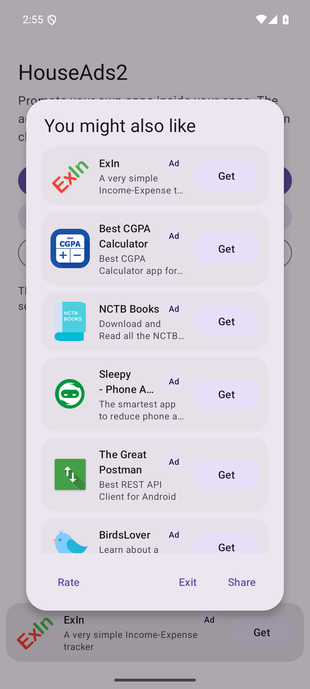

# HouseAds2

An Android library for promoting your own apps inside your own apps. It shows a banner, a full-screen list of your apps (an interstitial) and a rating dialog. The ads come from a JSON file you host yourself, so you can change them any time without shipping an update. There is no ad network, no tracking and no revenue share.

(Version 1 is here: https://github.com/p32929/MyHouseAdsAndroid)

## Features

1. **Banner ad** for one of your apps, with its icon, name, description and a Get button.
2. **Interstitial** with a list of all your apps, plus Share, Rate and Exit buttons. A good fit for the back button.
3. **Rating dialog** that sends 5-star users to the Play Store and asks everyone else for feedback by email.
4. **Rotating banners** that switch to the next app on a timer you choose.
5. **Change the ads without an update:** edit the JSON file and every install picks it up.
6. **Follows your app's look:** Material 3, light and dark mode. If your app uses a Material 3 theme, the ads use your colours.
7. **Small:** no image or networking library is added. It only depends on Material Components and RecyclerView.

## Screenshots

 

## Install

1. Add JitPack to `settings.gradle.kts`:

```kotlin
dependencyResolutionManagement {
    repositories {
        google()
        mavenCentral()
        maven("https://jitpack.io")
    }
}
```

2. Add the dependency:

```kotlin
dependencies {
    implementation("com.github.p32929:HouseAds2:2.0.0")
}
```

Needs Android 5.0 (API 21) or newer.

## The JSON file

Host a JSON array anywhere that serves plain text, for example a GitHub file opened with "Raw". Each app has four fields:

```json
[
  {
    "appIcon": "https://example.com/icon.png",
    "appName": "My Other App",
    "appDescription": "One short line about the app",
    "url": "https://play.google.com/store/apps/details?id=com.example.other"
  }
]
```

1. `appIcon`: link to a square icon image.
2. `appName`: the app's name.
3. `appDescription`: one or two short lines.
4. `url`: where a tap goes, usually the Play Store page.

If the list includes the app that is showing the ads, that entry is hidden automatically.

## Usage

### Kotlin

```kotlin
class MainActivity : AppCompatActivity() {
    private lateinit var houseAds: HouseAds

    override fun onCreate(savedInstanceState: Bundle?) {
        super.onCreate(savedInstanceState)
        setContentView(R.layout.activity_main)

        // Pass a LinearLayout to get a banner as soon as the ads load.
        houseAds = HouseAds(this, "https://your.site/ads.json", findViewById(R.id.adsLl))
        houseAds.autoChangeBannerAds(60)           // next app every 60 seconds
        houseAds.setFeedbackEmail("you@example.com") // turns on the rating dialog
        houseAds.shuffleBeforeShowingDialog()

        onBackPressedDispatcher.addCallback(this) { houseAds.showInterAds() }
    }
}
```

### Java

```java
HouseAds houseAds = new HouseAds(this, "https://your.site/ads.json", linearLayout);
houseAds.autoChangeBannerAds(60);
houseAds.setFeedbackEmail("you@example.com");

// Later, for example on back press:
houseAds.showInterAds();
```

### All methods

1. `HouseAds(context, url)` or `HouseAds(context, url, linearLayout)`: loads the ads. With a layout, a banner is added when they arrive.
2. `putBannerAds(linearLayout)`: shows a banner in a layout later.
3. `autoChangeBannerAds(seconds)`: switches the banner to the next app on a timer. It stops when the Activity closes.
4. `showInterAds()`: shows the list of your apps with Share, Rate and Exit.
5. `showRateDialog()`: shows the rating dialog. Without a feedback email it opens the Play Store directly.
6. `setFeedbackEmail(email)`: where feedback from 1 to 4 star ratings goes.
7. `setSharePreString(text)`: text placed before your Play Store link when sharing.
8. `shareApp()`: opens the share sheet with your app's link.
9. `shuffleBeforeShowingDialog()`: shows the apps in a random order in the interstitial.
10. `setListener(listener)`: lets you add your own views above the app list in the interstitial.

Check the `app` module for a full example.

## Migrating from 1.x

The main calls are the same, so most apps only need to change the version number.

1. **Minimum Android version** is now 5.0 (API 21), up from 4.0.3.
2. **Picasso is no longer included.** If your app used Picasso through this library, add it to your own dependencies.
3. **`setMenInBlack()` does nothing now.** The dialogs follow your app's theme, light or dark. It is kept so old code still compiles.
4. **Load errors no longer show a Toast** to your users. They are written to Logcat with the tag `HouseAds`.
5. **Removed helper classes:** `FayazSP`, `JsonObjectGetter` and `JsonObjectGetListener` were internal helpers and are gone.
6. **`MyAdView` is now a `FrameLayout`** instead of a `RelativeLayout`.
7. **Exit** in the interstitial still closes the Activity, as before.

## License

MIT License — Copyright (c) 2019 Fayaz Bin Salam. See [LICENSE](LICENSE) for the full text.

## Contributing

Contributions are warmly welcomed and greatly appreciated! Whether it's a bug fix, new feature, or improvement, your input helps make this project better for everyone.

Before submitting a pull request, please:

1. Create an issue describing the feature or bug fix you'd like to work on
2. Wait for discussion and approval to ensure alignment with project goals
3. Fork the repository and create your feature branch
4. Submit your pull request with a clear description of changes

This approach helps avoid duplicate efforts and ensures smooth collaboration. Thank you for considering contributing!

## Share

Sharing this repository with your friends is just one click away from here

[](https://www.facebook.com/sharer/sharer.php?u=https://github.com/p32929/HouseAds2/)
[](https://twitter.com/intent/tweet?url=https://github.com/p32929/HouseAds2/)
[](https://www.tumblr.com/share?v=3&u=https://github.com/p32929/HouseAds2/)
[](https://getpocket.com/save?url=https://github.com/p32929/HouseAds2/)
[](https://pinterest.com/pin/create/button/?url=https://github.com/p32929/HouseAds2/)
[](https://www.reddit.com/submit?url=https://github.com/p32929/HouseAds2/)
[](https://www.linkedin.com/shareArticle?mini=true&url=https://github.com/p32929/HouseAds2/)
[](https://api.whatsapp.com/send?text=https://github.com/p32929/HouseAds2/)

---

## Support

If this saved you time, you can buy me a coffee — it keeps these projects maintained and free. Other payment options: https://p32929.github.io/SendMoney2MeV1/

[](https://www.buymeacoffee.com/p32929)

<!-- hire-block -->

---

## 💼 Using this at a company?

I do fixed-price delivery work on my own projects. One invoice, one date, no hourly billing:

| | |
|---|---|
| **White-label build** — this project rebranded, extended and deployed as yours | **$6,500** · 3 weeks |
| **Custom app from scratch** on my own stack, signed and auto-updating | **$12,500** · 6 weeks |
| **Production-hardening sprint** — 72 hours on this project, for your load and your security review | **$999** |
| **Ongoing capacity** — one project-week of my time reserved every month | **$9,000 / month** |

Full details → **[p32929.github.io/hire](https://p32929.github.io/hire/)** · Email **[fayazdevinbox@uberip.com](mailto:fayazdevinbox@uberip.com)** — scoping and quotes are free and I answer within one business day.
